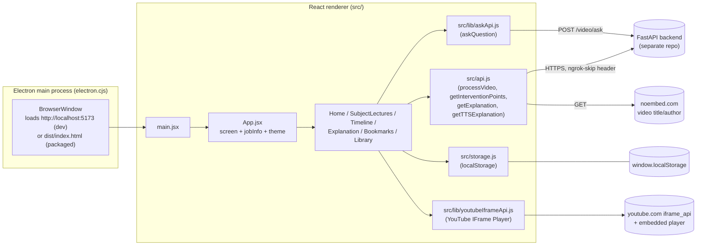
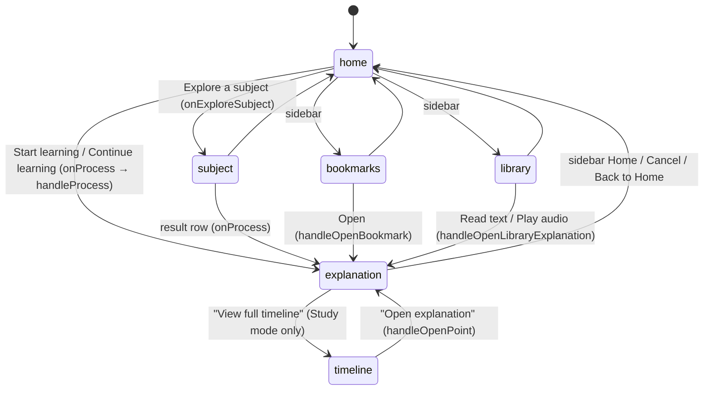

# Architecture

Part of the Synapse frontend docs — start at the [README](../README.md). Tags: **[Verified]** read from source, **[Inferred]**, **[Unknown]**.

## Glossary (project-specific terms)

| Term | Meaning |
|---|---|
| **Moment / intervention point / point** | A detected position in the lecture where a visual (equation, diagram, chart, graph, code, slide) appears. The UI says "moment"; the code and backend say "intervention" / "point". Same thing. |
| **Point ID (`pointId`)** | The backend's intervention `id` (a UUID string in real mode; `p1`–`p6` in mock mode). |
| **Job ID (`jobId`)** | Identifier of a processing job. In this frontend it is always set equal to the YouTube `videoId` (`App.jsx` `handleProcess`). |
| **Depth `mode`** | Explanation depth: `"brief" \| "standard" \| "detailed"`. Currently only `"standard"` is ever passed (`defaultDepth` in `Home.jsx`/`SubjectLectures.jsx`). Sent to the backend as `output_mode`. Never confuse with `presentationMode`. |
| **`presentationMode`** | `"accessibility"` (default) or `"study"`. Purely how the lecture screen is rendered. |
| **`pauseOwner`** | `null \| "user" \| "intervention"` — who currently owns the video's pause. Governs auto-resume. |
| **Explanation TTS** | The backend-generated audio of a moment's explanation, played via an HTML5 `Audio` element. Distinct from the **lecture audio** (the YouTube iframe). |
| **Announce** | A message pushed into the lecture screen's single polite `role="status"` live region via `announce()`. |
| **Mock mode** | `USE_MOCK = true` in `src/api.js`: fake processing, moments and audio. Ask is **not** mocked. |

## High-level view



## Electron main process vs React renderer

**Main process — `electron.cjs`** [Verified]: creates a single `BrowserWindow` (1400×900, minimum 1100×700, background `#F7F4EC`) with `contextIsolation: true` and **`webSecurity: false`**. It loads `http://localhost:5173` when `!app.isPackaged`, otherwise `dist/index.html` next to the file. It quits on all windows closed except on macOS and recreates a window on `activate`. There is **no preload script, no IPC, no custom menu, no auto-update, no file system access** from the renderer. `package.json` `"main"` is `electron.cjs`.

Consequences:
- The renderer is effectively a normal web app; everything (storage, network, audio) uses browser APIs. Electron-specific capabilities are not used anywhere in `src/` [Verified by grep: no `ipcRenderer`, `require("electron")`, `window.electron`].
- `webSecurity: false` means cross-origin `fetch` works in Electron without CORS but **not** in a regular browser tab. Code that works in Electron can fail under `npm run dev` in a browser until the backend sets CORS headers.
- Because `isDev = !app.isPackaged`, running `electron .` from the source tree always loads the dev server, never `dist/`.

**Renderer — `src/`** [Verified]: all application logic. Entry `index.html` → `src/main.jsx`.

## Startup sequence

1. `index.html` provides `<div id="root">` and loads `/src/main.jsx` (title "Synapse", `lang="en"`).
2. `src/main.jsx` imports self-hosted Fontsource CSS (Atkinson Hyperlegible Next 400/500/600/700, Mono 400/500) and `src/index.css`.
3. Before first render, it reads `localStorage["synapse_theme"]` (default `"paper"`) and sets `data-theme` on `<html>` to avoid a theme flash.
4. `createRoot(...).render(<StrictMode><App/></StrictMode>)`. StrictMode double-invokes effects in dev (see the `handledScreenRef` comment in `App.jsx`).
5. `App` initialises `screen = "home"`, `jobInfo = null`, `exploreSubject = null`, `hasLeftHome = false`, `theme` from storage, and renders: skip link → `Navbar` → active screen.

## Screen selection and navigation

There is **no router** [Verified]. `App.jsx` holds:

- `screen`: `"home" | "subject" | "timeline" | "explanation" | "bookmarks" | "library"`.
- `jobInfo`: `{ jobId, videoId, pointId?, mode, promise?, bookmarkData?, autoPlay? }` — the "current lecture" handed to Timeline/Explanation.
- `exploreSubject`: the subject name for `SubjectLectures`.
- `hasLeftHome`: so Home focuses its `<h1>` only when returning, never on cold start.

An `if / else if` chain picks the component (screens needing `jobInfo` fall through to Home if it is `null`). Browser Back/Forward do nothing — there is no URL state.



`handleNavigate(key)` (passed as `onNavigate` to every screen's `Sidebar`) handles only `"home"` (clears `jobInfo` and `exploreSubject`), `"bookmarks"` and `"library"`. The sidebar's "Home" item stays highlighted on Timeline/Explanation/Subject screens (they pass `active="home"`).

### Focus on screen change [Verified, `App.jsx`]

A `useEffect` on `screen` focuses the first `main h1` (setting `tabindex=-1`) whenever the screen changes, except the first render and except `"timeline"` (Timeline focuses its own `<h1>` once data loads). Window title is set per screen in a second effect; Explanation sets its own title to `"<moment title> – Synapse"`.

## Component hierarchy

```
App
├─ <a href="#main-content">Skip to main content</a>
├─ Navbar                      (Settings/theme panel)
└─ one of:
   ├─ Home                     ├─ Sidebar (in <nav>)
   │   └─ LectureResultsList   └─ useLectureSearch, useFocusShortcut
   ├─ SubjectLectures          ├─ Sidebar, LectureResultsList, hooks (same as Home)
   ├─ Timeline                 ├─ Sidebar, CategoryIcon, MomentMarker, LaneTimeline→Marker, PointRow, PreviewPanel
   ├─ Explanation              ├─ Sidebar, MomentMarker, ProvenanceLabel, CategoryIcon, AskLecture
   ├─ BookmarksScreen          ├─ Sidebar, CategoryIcon, BookmarkCard, EmptyState
   └─ LibraryScreen            └─ Sidebar, CategoryIcon, ExplanationCard, EmptyState
```

Every screen renders its own `<nav aria-label="Main navigation"><Sidebar/></nav>` and its own `<main id="main-content" tabIndex={-1}>`; the skip link targets that id. Details: [SCREENS_AND_COMPONENTS](./SCREENS_AND_COMPONENTS.md).

## State ownership (summary)

| State | Owner | Notes |
|---|---|---|
| Current screen, current lecture (`jobInfo`), subject, theme | `App.jsx` | Passed down as props; reset by `handleNavigate("home")`. |
| Search text/results/status | `useLectureSearch` (per Home/SubjectLectures mount) | Lost on unmount. |
| Moments list, active moment, explanation, audio, player, pause ownership, presentation mode, Ask | `Explanation.jsx` (Ask: `AskLecture.jsx`) | All local `useState`/`useRef`. Lost when leaving the screen (except what is persisted). |
| Bookmarks, Library, theme, presentation mode, TTS speed, intro-seen flag | `localStorage` | See [STORAGE](./STORAGE_AND_PERSISTENCE.md). |
| Backend processing result cache, explanation request cache | Module-level variables in `src/api.js` | `cachedResult`, `_explanationCache`, `mockJobStartTime`. |

Full flow: [DATA_FLOW_AND_STATE](./DATA_FLOW_AND_STATE.md).

## Main user flows

1. **New lecture:** Home → paste URL (or pick a search result) → `onProcess` → `App.handleProcess` calls `processVideo()` immediately (not awaited) and navigates to Explanation with the in-flight promise → Explanation shows an inline "Preparing your lecture… N%" banner, then loads moments → player auto-pauses at each moment → explanation text + audio.
2. **Resume from Library/Bookmarks:** opens Explanation directly at a saved `pointId` (no `processVideo` call; `promise` is `null`).
3. **Timeline:** Explanation (Study mode) → Timeline for the same lecture with the active point preselected → "Open explanation" returns.
4. **Ask a question:** inside Explanation → `AskLecture` → `askQuestion()` → `POST /video/ask` → answer/sources → source buttons seek the player.

## Boundaries

| Boundary | What crosses it |
|---|---|
| Frontend ↔ backend | JSON over HTTPS via `fetch` (`src/api.js`, `src/lib/askApi.js`), plus audio files fetched as blobs. See [API doc](./API_AND_BACKEND_INTEGRATION.md). The backend is **not** in this repo. |
| Frontend ↔ YouTube | Script `https://www.youtube.com/iframe_api` and the embedded player; the app controls it via `playerRef` (`playVideo`, `pauseVideo`, `seekTo`, `getCurrentTime`, `getPlayerState`, `cueVideoById`, `destroy`). |
| Frontend ↔ third parties | `noembed.com` (title/author), `i.ytimg.com` (thumbnails), Google Fonts (CSS `@import`). |
| Browser APIs used | `localStorage`, `Audio`, `URL.createObjectURL`, `matchMedia` (reduced motion), `fetch`/`AbortController`, `window` keydown/custom events. |
| Electron capabilities | None beyond hosting the window (see above). |
