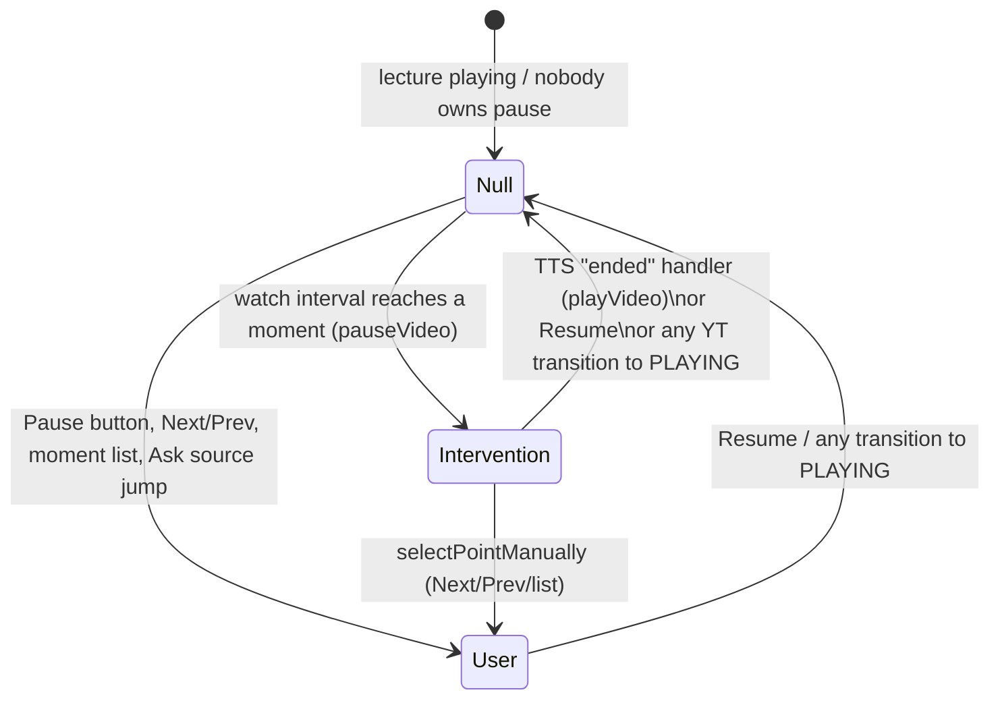

# Data Flow and State

How data moves through the Synapse frontend. Companion to [ARCHITECTURE](./ARCHITECTURE.md) and [SCREENS_AND_COMPONENTS](./SCREENS_AND_COMPONENTS.md). Tags: **[Verified]** (read from source), **[Inferred]**, **[Unknown]**.

## 1. Identifiers and what they mean

| Name | Origin | Used for |
|---|---|---|
| `videoId` | `extractYouTubeId(url)` or a search result (`src/lib/lectureSearch.js`) — 11 chars `[A-Za-z0-9_-]` | YouTube player, thumbnails, all backend calls, storage ids. |
| `jobId` | Always `= videoId` (`App.handleProcess`: `setJobInfo({ jobId: videoId, videoId, … })`) | Passed to `getInterventionPoints(jobId, videoId)`; stored with saved items. The separate `/api/jobs/:id` poller (`getJobStatus`) is **not called anywhere** [Verified]. |
| `pointId` (= intervention id) | Backend `iv.id`; `p1`–`p6` in mock mode | Which moment is active; `intervention_id` to the backend; part of the storage id `` `${videoId}-${pointId}` ``. |
| `timestamp` (point) | String `"m:ss"`/`"mm:ss"`/`"h:mm:ss"` | Display and (after parsing) seeking/auto-pause. Real data: backend `timestamp_formatted` with a leading `"00:"` stripped (`src/api.js` `getInterventionPoints`). |
| `mode` | Depth string (`"standard"`) | Sent to the backend as `output_mode`; part of `_explanationCache` key; saved with bookmarks/library items. |

## 2. Core data shapes (verified from source)

**`jobInfo`** (`App.jsx`): `{ jobId, videoId, mode, promise?, pointId?, bookmarkData?, autoPlay? }`. `promise` only exists when arriving from Home/Subject; `pointId` is set by Timeline/Bookmarks/Library or when returning from Explanation → Timeline.

**Point** (output of `getInterventionPoints().points[]`):

```js
{
  id: string,
  category: "equation" | "diagram" | "chart" | "graph" | "code" | <any other string>,
  timestamp: string,                 // "0:10", "01:32", ...
  title: string,                     // real mode: first 6 words of transcript_context
  focusRegion?: { x, y, w, h },      // percentages of the frame; passthrough only
  structured?: { rows: [{ label, value }] }, // passthrough only
  // real mode only:
  _frame_path, _transcript
}
```

Real-mode mapping rules [Verified, `src/api.js`]: `non-educational` interventions are filtered out; `content_type "slide"` becomes category `"diagram"`; `focusRegion`/`structured` are copied only if the backend sends them (it does not yet — see comments in `src/api.js`).

**`getInterventionPoints` result:** `{ jobId, videoTitle, author, duration, points }` (title/author from `noembed.com` via `getVideoMetadata`, with fallbacks).

**Explanation** (`getExplanation` result): `{ pointId, subtitle, paragraphs: string[], keyInsight: string }`. In real mode it is derived from the backend's `text_explanation` by `parseTextExplanation`: split on blank lines; subtitle = first sentence of the first paragraph; if more than two paragraphs the last becomes `keyInsight` and is removed from the body. If the backend ever sends `explanation`/`keyInsight` fields, they are preferred automatically.

**TTS result** (`getTTSExplanation`): `{ intervention_id, text_explanation, audio_file_path, output_mode }` where `audio_file_path` has been replaced by a **blob URL** (real mode: the audio file is fetched with the ngrok header and wrapped via `URL.createObjectURL`; mock mode: a generated WAV).

**Ask result** (`askQuestion`): `{ status, scope, answer_text, sources: [{start_seconds, end_seconds, intervention_id}] }`. See [API doc](./API_AND_BACKEND_INTEGRATION.md).

Stored shapes (bookmark, library item): [STORAGE_AND_PERSISTENCE](./STORAGE_AND_PERSISTENCE.md).

## 3. Main flow: pasted link → explanation

```mermaid
sequenceDiagram
  actor U as Student
  participant H as Home + useLectureSearch
  participant A as App.jsx
  participant E as Explanation.jsx
  participant API as api.js
  participant BE as Backend
  participant YT as YouTube iframe
  U->>H: types/pastes URL, presses Enter
  H->>H: extractYouTubeId(url) → videoId
  H->>A: onProcess({url, videoId, mode})
  A->>API: processVideo(...) (not awaited) → promise
  A->>E: screen="explanation", jobInfo{promise,...}
  API->>BE: POST /video/process {youtube_url}  (real mode)
  BE-->>API: {title, duration_*, interventions[]}  → cachedResult
  E->>E: banner "Preparing your lecture… N%" (estimated)
  API-->>E: promise resolves → isProcessing=false
  E->>API: getInterventionPoints(jobId, videoId) → points
  E->>YT: new YT.Player(...) (effect on videoId)
  E->>API: getExplanation + getTTSExplanation (point 1)
  API->>BE: POST /video/intervention/explain {video_id, intervention_id, output_mode}
  BE-->>API: {text_explanation, audio_file_path,...}
  API->>BE: GET audio file → blob URL
  U->>E: Play lecture
  YT-->>E: playing; 300ms interval watches getCurrentTime()
  E->>YT: pauseVideo() at a moment (pauseOwner="intervention")
  U->>E: Listen (Alt+L)
  E-->>E: Audio "ended" → playVideo() (only if pauseOwner==="intervention")
```

In **mock mode** the same flow runs, but `processVideo` resolves after 400 ms with `{jobId: videoId}`, `getInterventionPoints` returns the six `MOCK_INTERVENTIONS` (timestamps `0:10`, `0:14`, `1:30`, `3:00`, `5:45`, `8:20`), and explanation/audio come from the same table. Only `noembed.com` and YouTube are contacted.

### Loading / empty / error states (verified)

| State | Where | Behaviour |
|---|---|---|
| Processing | `Explanation` banner (`isProcessing`) | Non-blocking banner "Preparing your lecture… N%" (visual only) with an sr-only `role="status"` "Preparing your lecture. This can take about a minute." and a Cancel button (→ Home). Progress is a time estimate (90 s), not real backend progress. |
| Processing failure | `processingError` | `role="alert"` banner "Something went wrong while preparing this lecture." + "Back to Home". The underlying error is swallowed (no console log in this branch). |
| Moments failed to load | effect `.catch` | `console.error("Failed to load points:", err)` only — **no UI error** [Verified]. The `<h1>` stays "Loading your lecture". |
| Explanation failed | effect `.catch` | `console.error` only; subtitle stays "Loading this explanation…" [Verified]. |
| TTS failed / no audio | effect `.catch` / `audioUrl` null | Listen button is `aria-disabled` and dimmed; "Loading audio…" shown while `audioLoading`. If the audio file cannot be fetched in real mode, a `console.warn` is logged and `audio_file_path` becomes `null`. |
| No moments | `allPoints=[]` | Prev/Next absent; moments list not rendered. |
| Search | `useLectureSearch.statusMessage` | "Searching." → "N lectures found." / "No lectures found. Try another search term or paste a YouTube link." / "Please enter a lecture link or a search term." |
| Ask | `AskLecture` | Loading, error (`role="alert"`), and three result statuses — see [API doc](./API_AND_BACKEND_INTEGRATION.md#ask-a-question-post-videoask). |
| Empty Library/Bookmarks | `EmptyState` | Text-only empty states. |

## 4. YouTube playback vs explanation TTS

Two independent media sources run on the lecture screen. Keeping them separate is the central design rule.

| | Lecture video/audio | Explanation TTS |
|---|---|---|
| Source | YouTube IFrame `YT.Player` in `playerRef` | `new Audio(blobUrl)` in `audioRef` |
| State vars | `playerState` (`unstarted/playing/paused/buffering/ended`), `playerReady`, `pauseOwner` | `isPlaying`, `currentTime`, `audioDuration`, `audioUrl`, `audioLoading`, `playbackRate`, `playedPointIds` |
| Controls | "Play/Pause/Resume lecture" (Accessibility mode, Alt+P), Resume video (Study), YouTube's own controls (Study) | Listen/Pause button (Alt+L), Listening speed select (Alt+. / Alt+,) |
| Truth source | YouTube `onStateChange` (also fires when the user uses native controls) | the `Audio` element events |

`pauseOwner` (`null | "user" | "intervention"`, mirrored in `pauseOwnerRef`) is the single source of truth for auto-resume:



Rules [Verified in `Explanation.jsx`]:
- The watch interval exists **only while `pauseOwner === null`** (and `playerReady`). That is what prevents two close moments from re-triggering while one is being explained. It also means no new moment is detected while a user-owned pause is active.
- Each moment auto-triggers at most once per visit (`triggeredPointIdsRef`); manual selection adds the moment to the set so the first Resume does not instantly re-pause.
- Auto-resume happens **only** from the audio `ended` handler and only if `pauseOwnerRef.current === "intervention"`. Pressing Resume lecture stops the explanation audio first.
- Spoken "Playing."/"Paused." come from `expectPlayerState` + `onStateChange`, never from the keypress.
- Video elements are never unmounted when switching presentation modes (`sr-only` + `inert` in Accessibility mode; not `display:none`, which would pause the iframe).
- Explanation text never goes into a live region, so it is not read twice alongside TTS.

## 5. State resets and preservation

- **Leaving a screen unmounts it** (single-screen conditional render in `App.jsx`), so all local state — search results, moments, player, Ask answer, text scale, high contrast — is discarded [Inferred from the render structure]. Persisted: theme, presentation mode, TTS speed, intro-seen flag, bookmarks, library.
- **Module-level caches persist across screens within a session:** `cachedResult` (last processed video, `src/api.js`), `_explanationCache` (keyed `videoId::interventionId::mode`), `mockJobStartTime`.
- **Changing the active moment** (effect on `[effectiveActivePointId, mode, videoId]`) resets `currentTime`, `isPlaying`, `audioUrl`, sets `audioLoading`, clears `focusActive`, recomputes `bookmarked`. `explanation` is cleared unless it was preloaded from a bookmark (`preloadedExpl`).
- **Changing `videoId`** destroys/recreates the player and clears `playedPointIds`. (In practice a different `videoId` means a different screen mount.)
- **Home**: `hasLeftHome` (App) prevents H1 focus on cold load.
- **Timeline round-trip:** `handleOpenTimeline(pointId)` stores `pointId` in `jobInfo`, so Timeline and later Explanation reopen at the same moment; video position is not preserved.
- **Ask:** `AskLecture` is keyed by `videoId`; it keeps its answer while the active moment changes (it is lecture-wide), but loses it on leaving the screen.
- **Library/Bookmark entry:** `bookmarkData` seeds a one-point `allPoints`, the title and the explanation; the full moment list is still requested from the backend.

## 6. Known race conditions and coupling

1. **Stale explanation responses** are guarded by the `cancelled` flag in the explanation effect; the TTS audio effect creates a new `Audio` per `audioUrl` and pauses the old one on cleanup.
2. **Ask** guards with `requestIdRef`, `busyRef` and `AbortController` (aborts on unmount/video change).
3. **Announcements are timer-based** (`announce` clears then sets after 60 ms and clears after 5 s; `expectPlayerState` has a 5 s timer). Two announcements within ~60 ms replace each other; this is intentional but means rapid events can drop a message.
4. **`focusExplanationStart`** uses `setTimeout(…, 0)`; focus can land before the heading re-renders if state updates are batched oddly [Inferred].
5. **Coupling to know about:** `AskLecture` depends on `Explanation`'s `pauseOwner` to decide whether to send `intervention_id`, and on `selectPointManually` for moment sources; Timeline/Bookmarks/Library rely on the exact `jobInfo` field names; the auto-save effect writes to the Library whenever a moment's explanation loads (a read action creates persistent data).
6. **Real mode needs `processVideo` in the same session:** `getInterventionPoints` throws `"No cached result. Process the video first."` if `cachedResult` is missing or for a different video. Opening from Library/Bookmarks after an app restart in real mode therefore cannot load the moment list [Verified code; runtime behaviour **[Unknown]** without a backend].
7. **Audio blob URLs are never revoked** in `src/api.js`, so each loaded explanation keeps its blob until the page unloads.
